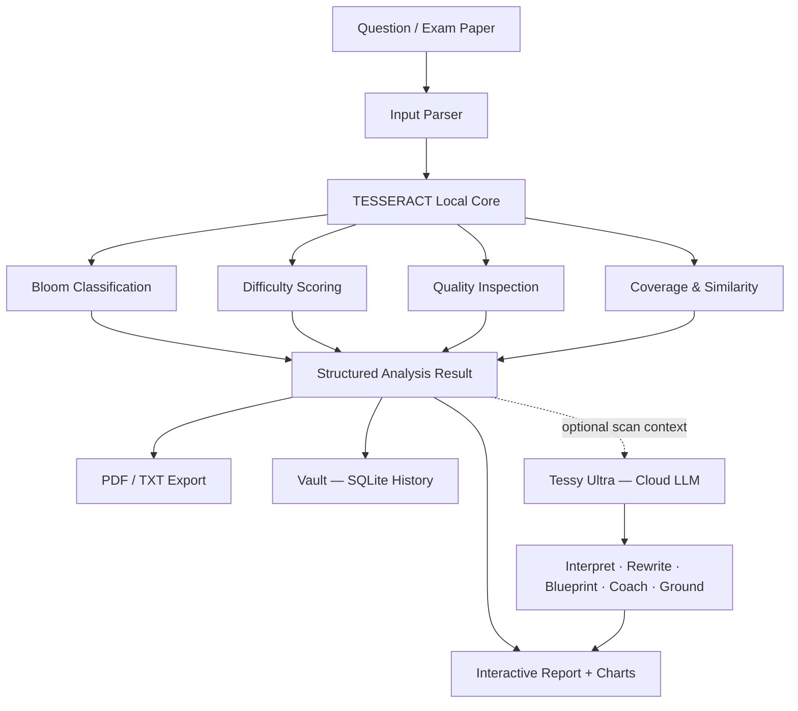
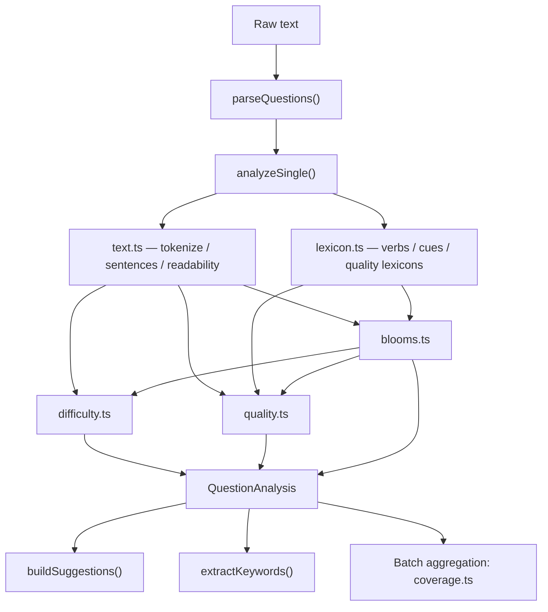
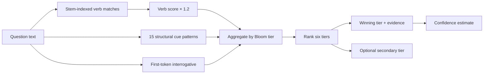
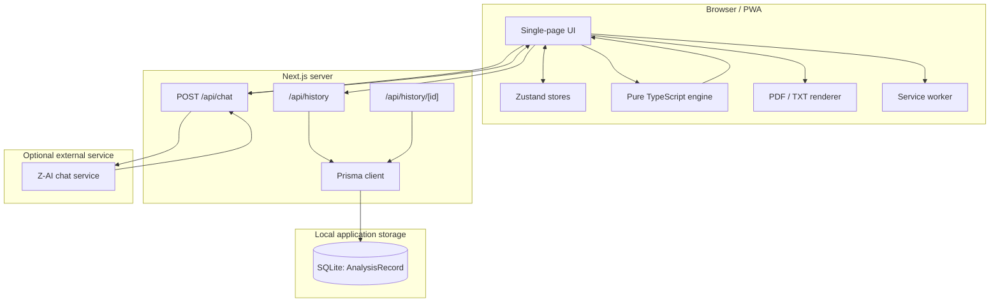
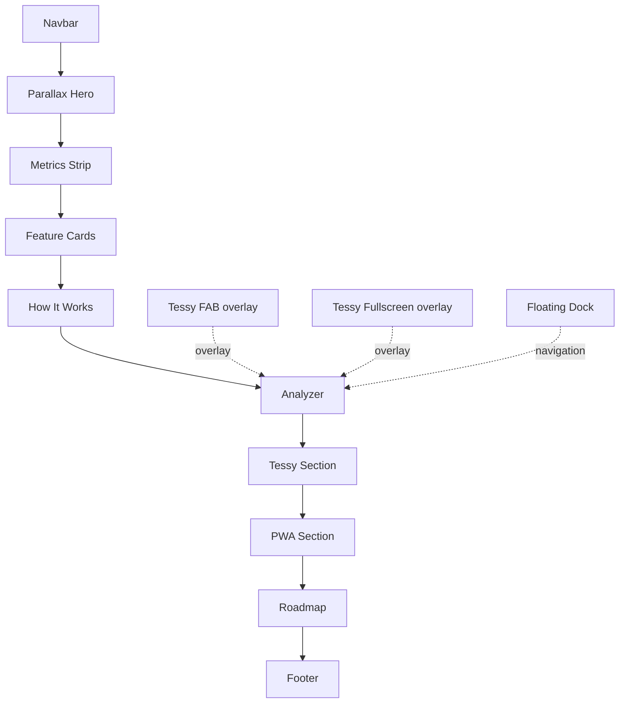
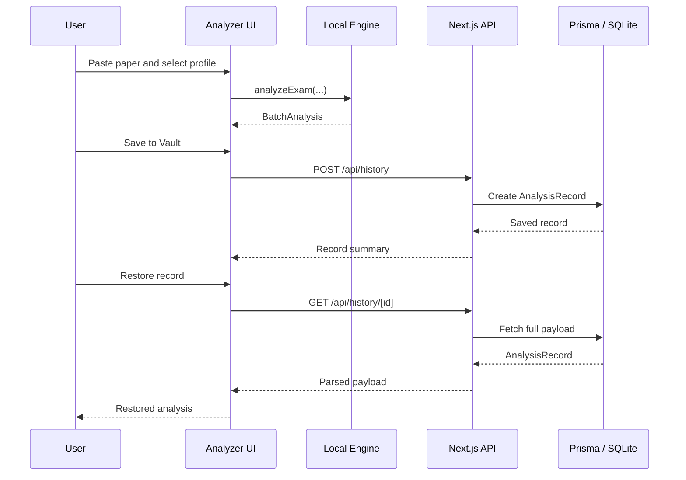

# TESSERACT
### AI Exam Question Quality Analyzer

**Inspect the cognitive level. Measure the difficulty. Audit the quality. Balance the paper.**

A Progressive Web App for analysing individual exam questions and complete question papers through a deterministic, offline-first TypeScript analysis engine — with an optional cloud reasoning companion.

<br/>


<br/>

[Overview](#-overview) · [Features](#-feature-system) · [Engine](#-the-analysis-engine) · [Formulas](#-complete-formula-reference) · [Architecture](#-architecture) · [API](#-api-reference) · [Setup](#-getting-started) · [Roadmap](#-roadmap)

</div>

---

> [!IMPORTANT]
> **What “AI” means in this project:** the core analyzer is a deterministic, rule-based NLP/scoring engine written in TypeScript. It does **not** run a neural network, train a model, or call an external API to score questions. The same input produces the same local result. **Tessy Ultra** is a separate, optional cloud-LLM layer used to explain reports, coach users, and rewrite questions. It does not calculate the local scores.

## ✦ Overview

TESSERACT is an assessment-quality inspection system. It takes a question or a complete exam paper and produces a structured analysis of:

- **Bloom’s Taxonomy:** estimates the cognitive tier from Remember through Create, with confidence and evidence signals.
- **Difficulty:** calculates a 0–100 composite score from five weighted factors, including readability, cognitive demand, lexical density, abstraction, and information load.
- **Question quality:** estimates clarity and specificity, and reports potential defects such as vague wording, hedging, excessive negation, biased language, absolutist wording, and excessive length.
- **Paper coverage:** compares the paper’s Bloom distribution with a selected blueprint, measures difficulty spread, estimates topical diversity, and identifies near-duplicate questions.
- **Repair guidance:** produces actionable suggestions linked to detected issues.
- **Reports:** exports detailed single-question or paper-level reports to PDF and plain text.
- **History:** stores batch analyses in a local SQLite database through Prisma, allowing saved scans to be restored or deleted.
- **Installability:** provides an installable PWA with a service worker and an offline-capable app shell.

### The two-layer intelligence model



| Layer | Responsibility | Network requirement |
|---|---|---|
| **Local Core** | Parsing, Bloom signals, difficulty, quality, coverage, similarity, suggestions | No external API required for scoring |
| **Tessy Ultra** | Conversational interpretation, rewriting, blueprint assistance, coaching | Requires the configured cloud AI service |
| **Vault** | Persist and restore batch-analysis snapshots | Uses the app's history API and SQLite database |
| **PWA shell** | App installation and cached app-shell fallback | First visit requires the app to be served; offline behavior depends on cached assets |

### Project facts

| Attribute | Details |
|---|---|
| Product | TESSERACT — AI Exam Question Quality Analyzer |
| Version described by the project blueprint | `v2.1` |
| Application shape | Single-route application (`/`) with sections and overlays |
| Core language | TypeScript |
| Analysis mode | Deterministic, rule-based, local |
| Bloom tiers | 6 |
| Difficulty factors | 5 |
| Exam blueprint profiles | 4 |
| Maximum parsed questions | 60 |
| Persistence | Prisma + SQLite |
| Export formats | PDF and TXT |
| Optional assistant | Tessy Ultra |
| Delivery | Progressive Web App |

---

## ◈ Feature system

### 1. Single-question scan

Inspect one question and receive an item-level diagnostic.

| Output | What it tells you |
|---|---|
| Difficulty score | Composite score from 4–98, displayed on a 0–100-style instrument |
| Difficulty band | Foundational, Intermediate, Advanced, or Expert |
| Bloom tier | Estimated cognitive process |
| Confidence | Strength of the winning Bloom signal relative to alternatives |
| Evidence trail | Detected verbs and structural cues behind the classification |
| Secondary tier | A second plausible tier when its score is sufficiently close |
| Clarity | Rule-based estimate of wording clarity |
| Specificity | Rule-based estimate of how concrete and constrained the prompt is |
| Defect flags | Potential wording or construction problems |
| Keywords | Up to six extracted topic keywords |
| Repair protocol | Up to six targeted improvement suggestions |

### 2. Full exam-paper scan

Paste a complete paper and inspect its overall structure.

- Bloom distribution against the chosen blueprint.
- Lower-, middle-, and higher-order cognitive proportions.
- Average question difficulty and population standard deviation.
- Four-band difficulty distribution and spread score.
- Pairwise keyword-Jaccard similarity and near-duplicate pairs.
- Overall balance index and composite verdict.
- Strengths, weaknesses, insights, and a priority recommendation.
- A question-by-question table with expandable diagnostics.

### 3. Four blueprint profiles

The local engine uses these ideal Bloom distributions, ordered as **Remember, Understand, Apply, Analyze, Evaluate, Create**.

| Profile | REM | UND | APP | ANZ | EVA | CRE | Intended emphasis |
|---|---:|---:|---:|---:|---:|---:|---|
| Balanced | 30% | 25% | 18% | 14% | 8% | 5% | Broad cognitive balance |
| Formative | 45% | 30% | 15% | 7% | 2% | 1% | Recall and understanding |
| Summative | 22% | 26% | 24% | 16% | 8% | 4% | Broad end-of-unit assessment |
| Competitive | 12% | 18% | 26% | 24% | 13% | 7% | Greater analysis and higher-order demand |

These are built-in heuristic targets, not universal accreditation standards. A real assessment blueprint should be adapted to the course outcomes, level, marks, time, and institutional requirements.

### 4. Tessy Ultra — optional AI co-pilot

Tessy Ultra is the conversational layer, not the scoring engine. Its prompt contract defines five capabilities:

| Capability | Function |
|---|---|
| **INTERPRET** | Explain the actual scan metrics, evidence, flags, balance, spread, and duplicate findings |
| **REWRITE** | Rewrite a question toward a requested Bloom tier or difficulty band |
| **BLUEPRINT** | Help design a paper structure by Bloom tier, difficulty, marks, and timing |
| **COACH** | Explain item-writing, distractor quality, cueing, rubrics, and assessment design |
| **GROUND** | Answer assessment-science questions using Revised Bloom’s Taxonomy framing |

When rewriting, Tessy is instructed to preserve the construct, select one strong directive verb, keep reading load appropriate, and explain **Original → Rewritten → Why**. Increasing difficulty should add meaningful data, constraints, multi-step reasoning, or a novel context — not merely obscure wording.

If a scan is attached, a compact scan context is sent with the chat request. The prompt explicitly tells Tessy to interpret those supplied values and not to claim that it ran the local engine.

### 5. The Vault

Batch scans can be saved as `AnalysisRecord` rows in SQLite. The stored payload allows the app to restore a snapshot and export it again.

- List recent saved records (latest 24).
- Restore a saved batch scan into the analyzer.
- Delete an archived record.
- Retain summary metadata such as profile, question count, balance, average difficulty, and Bloom counts.

### 6. Report export

**TXT report**
- Fixed-width 84-column layout.
- Masthead and section separators.
- Key/value rows, paragraphs, bullets, subheadings, and explanatory notes.
- “WHAT THIS MEANS” explanations for interpreting metrics.

**PDF report**
- A4 portrait layout.
- Letter-spaced TESSERACT masthead.
- Headline and metadata block.
- Section headings, hairlines, key/value rows, bullets, and explanatory notes.
- Automatic page breaks and page-number footers.
- PDF-safe substitutions for characters not supported by jsPDF’s built-in Helvetica/WinAnsi encoding.

The PDF library is dynamically imported when the user requests a PDF, rather than being loaded into the initial application bundle.

### 7. Progressive Web App

- Web app manifest with standalone display mode.
- 192px, 512px, and maskable icon variants.
- Service worker registration.
- Install prompt capture where the browser supports it.
- `appinstalled` and standalone-display detection.
- Network-first handling for GET requests with cached app-shell fallback.
- API requests are excluded from the service-worker cache strategy.

> **Offline boundary:** the local scoring engine is designed to run without a scoring API. Tessy Ultra needs network access. The Vault's current persistence path uses the app's API and SQLite; do not assume remote history operations work while offline. Offline reload depends on the app shell having been cached previously.

---

## ⌁ The analysis engine

The engine lives in `src/lib/engine/` and is described as pure TypeScript, browser/server compatible, deterministic, and network-independent.



### Engine modules

| File | Responsibility |
|---|---|
| `types.ts` | Shared engine input/output types |
| `index.ts` | Orchestration, parsing, keyword extraction, suggestions, single/batch analysis |
| `text.ts` | Tokenization, sentence splitting, syllable heuristic, stemming, readability, statistics |
| `lexicon.ts` | Bloom verb weights, structural cues, interrogatives, quality lexicons, stopwords |
| `blooms.ts` | Bloom-tier signal aggregation and confidence |
| `difficulty.ts` | Five-factor difficulty calculation |
| `quality.ts` | Clarity, specificity, and defect flags |
| `coverage.ts` | Blueprint comparison, spread, diversity, duplicates, verdict |
| `meta.ts` | Display labels, short codes, monochrome metadata |
| `samples.ts` | Built-in sample question and sample paper |

### 1. Text-processing primitives

The engine uses lightweight heuristics rather than a heavyweight NLP dependency.

**Word extraction**

```ts
const WORD_RE = /[A-Za-z][A-Za-z'’-]*/g;
```

**Sentence splitting**

Sentences are split on punctuation boundaries matching:

```regex
[.!?;]+(?=\s|$)|\n+
```

**Syllable estimate**

The syllable counter uses a vowel-group heuristic:

1. Words of three characters or fewer are assigned one syllable.
2. Strip selected silent endings using `(?:[^laeiouy]es|ed|[^laeiouy]e)$`.
3. Strip a leading `y`.
4. Count vowel groups matching `[aeiouy]{1,2}`.
5. Add one for a terminal consonant + `le` pattern.
6. Enforce a minimum of one syllable.

This is an approximation. It is not a pronunciation dictionary and can miscount names, technical terms, abbreviations, and irregular English words.

**Porter-lite stemming**

The simplified stemmer applies the following suffix rules in order:

| Rule | Condition |
|---|---|
| `ies → y` | Word length greater than 4 |
| Remove `ing` | Word length greater than 5 |
| Remove `ed` | Word length greater than 4 |
| Remove `es` | Word length greater than 4 |
| Remove final `s` | Word length greater than 3, except `ss` |

**Readability**

Let:
- \(wc\) = word count
- \(sc\) = sentence count
- \(syl\) = estimated syllable count

Flesch Reading Ease:

\[
FRE = 206.835 - 1.015\left(\frac{wc}{sc}\right)
      - 84.6\left(\frac{syl}{wc}\right)
\]

The result is clamped to the range **0–121**.

Flesch–Kincaid Grade:

\[
FKG = 0.39\left(\frac{wc}{sc}\right)
      + 11.8\left(\frac{syl}{wc}\right) - 15.59
\]

The result is clamped to **0–18**.

For questions with fewer than five words, the engine uses the documented fallback values **grade = 3** and **ease = 90** to avoid unstable short-text ratios.

Other helpers include `clamp`, `round1`, `mean`, and population `stdev`.

### 2. Bloom’s Taxonomy classifier

The classifier estimates one of six Revised Bloom cognitive processes:

<details>
<summary><strong>View the six cognitive tiers and example directive verbs</strong></summary>

| Tier | Short code | Example signals |
|---|---|---|
| Remember | `REM` | define, list, recall, memorize, name, state, identify |
| Understand | `UND` | explain, summarize, paraphrase, interpret, describe, classify |
| Apply | `APP` | apply, solve, calculate, compute, demonstrate, implement |
| Analyze | `ANZ` | analyze, differentiate, distinguish, examine, contrast, investigate |
| Evaluate | `EVA` | evaluate, judge, critique, justify, defend, assess |
| Create | `CRE` | design, develop, formulate, compose, generate, plan, invent |

</details>

#### Weighted verb lexicon

The project blueprint describes **112 weighted directive verbs**. The weights mean:

- `3` — signature verb
- `2` — strong supporting verb
- `1` — supporting verb

The complete verb inventory specified in the project:

| Bloom tier | Verbs and weights |
|---|---|
| Remember | define 3, list 3, recall 3, memorize 3, name 2, state 2, identify 2, label 2, retrieve 2, reproduce 2, recognize 1, match 1, select 1, cite 1, arrange 1, locate 1, underline 1, tell 1 |
| Understand | explain 3, summarize 3, paraphrase 3, interpret 3, describe 2, classify 2, compare 2, discuss 2, illustrate 2, translate 2, restate 2, exemplify 2, outline 1, review 1, estimate 1, indicate 1, give 1 |
| Apply | apply 3, solve 3, calculate 3, compute 3, demonstrate 3, implement 2, execute 2, use 2, show 2, perform 1, operate 1, practice 1, sketch 1, dramatize 1, sequence 1, modify 1, chart 1 |
| Analyze | analyze 3, differentiate 3, distinguish 3, examine 3, contrast 2, test 2, experiment 2, investigate 2, deconstruct 2, derive 2, infer 2, diagnose 2, troubleshoot 2, dissect 2, attribute 2, probe 1, detect 1, survey 1, diagram 1, relate 1 |
| Evaluate | evaluate 3, judge 3, critique 3, justify 3, defend 3, assess 2, prioritize 2, appraise 2, argue 2, debate 2, rate 2, rank 2, recommend 2, decide 2, weigh 2, verify 2, validate 2, criticize 2, challenge 1, check 1 |
| Create | design 3, develop 3, formulate 3, compose 3, generate 3, plan 3, devise 3, synthesize 3, invent 3, create 3, construct 2, produce 2, build 2, author 2, propose 2, assemble 2, integrate 2, theorize 2, model 1, make 1 |

The verb signal is stem-indexed and multiplied by **1.2** in the described pipeline.

#### Structural cues

The classifier also looks for phrase patterns that imply a cognitive operation, even when the exact directive verb is absent.

| Structural pattern | Tier | Weight |
|---|---|---:|
| compare and contrast | Analyze | 3 |
| `why` | Analyze | 2 |
| what would / will happen | Analyze | 2 |
| cause / effect / impact / implication | Analyze | 1 |
| how would / can / could / do / does / did / might | Apply | 2 |
| step-by-step / procedure / process | Apply | 1 |
| which / what … best / most appropriate / most suitable | Evaluate | 2 |
| critically / pros and cons / strengths and weaknesses | Evaluate | 2 |
| justify / defend / argue / take a position | Evaluate | 2 |
| design / blueprint / draft / propose / devise / invent / plan | Create | 2 |
| come up with | Create | 2 |
| synthesize / integrate / combine | Create | 2 |
| definition / terms / facts / dates / names | Remember | 1 |
| state / list followed by an object phrase | Remember | 2 |
| in your own words / summarize / main idea / gist | Understand | 2 |

#### Interrogative fallback signals

These apply only when the interrogative is the first token:

| First token | Tier | Weight |
|---|---|---:|
| what / who / when / where | Remember | 0.8 |
| which | Understand | 0.6 |
| how | Apply | 1.2 |
| why | Analyze | 1.5 |

#### Classification pipeline and confidence



Let:
- \(top\) = winning tier score
- \(second\) = second-highest tier score
- \(margin\) = normalized gap between the two
- \(strength\) = normalized strength of the winning score

\[
margin = \frac{top-second}{top}
\]

\[
strength = \frac{\min(top,8)}{8}
\]

\[
confidence =
clamp(0.4 + 0.35 \cdot margin + 0.25 \cdot strength,\ 0.35,\ 0.97)
\]

Special cases and supporting outputs:

- If there are **zero signals**, the classifier falls back to **Understand**, confidence **0.30**, and no detected verb.
- A secondary tier is retained when its score is greater than zero and `second / top > 0.6`.
- `detectedVerb` is the highest-weight verb signal belonging to the winning tier.
- The evidence list contains up to the six strongest signals.

**Interpretation warning:** a directive verb is not proof of cognitive demand. “Explain” can ask for simple recall, while a well-designed problem without a textbook verb can require analysis. TESSERACT exposes evidence and confidence to make the heuristic inspectable; human review remains necessary.

### 3. Difficulty X-Ray

The difficulty engine combines five normalized factors.

Base cognitive values by Bloom tier:

```ts
const BLOOM_TIER_BASE = [18, 34, 50, 66, 82, 94];
// Remember → Understand → Apply → Analyze → Evaluate → Create
```

| Factor | Weight | Calculation |
|---|---:|---|
| Readability | 0.28 | `clamp((FKgrade / 16) × 100)`; if `wc < 5`, use grade 3 / ease 90 |
| Cognitive weight | 0.30 | `clamp(TIER_BASE[tier] + 6 if a directive verb was detected)` |
| Lexical density | 0.17 | `clamp(((longRatio × 1.9 + contentRatio) / 2.9) × 100)` |
| Abstraction | 0.13 | `clamp((abstractSuffixHits / max(6, wc)) × 340)` |
| Information load | 0.12 | See the piecewise function below |

Where:
- `longRatio` = proportion of words estimated to have at least three syllables.
- `contentRatio` = proportion of non-stopword stems longer than two characters.
- `abstractSuffixHits` = count of matches against the configured abstract-suffix lexicon.
- `wc` = word count.

Information-load function:

\[
Load(wc)=
\begin{cases}
\frac{wc}{28}\times68 & wc \leq 28\\
clamp(68+(wc-28)\times1.4) & wc > 28
\end{cases}
\]

Composite score:

\[
DifficultyComposite =
0.28R + 0.30C + 0.17L + 0.13A + 0.12I
\]

\[
DifficultyScore =
round(clamp(DifficultyComposite,\ 4,\ 98))
\]

Here \(R\), \(C\), \(L\), \(A\), and \(I\) are the five factor values, each on a normalized 0–100 scale.

Difficulty labels:

| Score | Label |
|---:|---|
| `< 32` | Foundational |
| `32–54` | Intermediate |
| `55–75` | Advanced |
| `≥ 76` | Expert |

Each factor also carries a human-readable detail string, for example, `Flesch-Kincaid grade 7.2`.

> **Important distinction:** this is an engineered text-and-cognitive-demand estimate, not an empirical measurement of how difficult students actually find an item. Actual difficulty requires learner-response data and validation.

### 4. Quality Inspector

The quality module produces two scores — **Clarity** and **Specificity** — and a set of defect flags.

#### Clarity score

Starts at **100**.

| Condition | Penalty | Flag / behavior |
|---|---:|---|
| Each sentence longer than 30 words | −10 each, capped at 30 | Load flag |
| Each hedge term | −7 each, capped at 28 | Ambiguity flag; high severity when more than one |
| Each negation marker | −9 each, capped at 18 | High-severity flag |
| Double-negative pattern | −12 | Regex-based flag |
| Question words detected but no `?` | −6 | Low-severity format flag |
| Final result | Clamp to 15–100 | |

Double-negative pattern:

```regex
\bnot\b[^.]{0,30}\b(not|without)\b|\bneither\b[^.]{0,30}\bnor\b
```

#### Specificity score

Starts at **55**.

| Condition | Adjustment |
|---|---:|
| Any digit is present | +14 |
| Technical marker is present | +10 |
| Higher-order directive verb is present | +12 |
| Word count is between 12 and 45 inclusive | +6 |
| Each vague-term hit | −14 |
| Remember-level question with fewer than 10 words | −10 |
| More than three sentences | −8 and a load flag |
| Final result | Clamp to 5–98 |

The technical-marker expression includes symbols and units such as:

```regex
\d|%|=|×|÷|+|√|∑|∫|kg|m/s|km|cm|mm|ml|°|\$\d
```

The quality lexicons specified in the project:

| Lexicon | Terms / patterns |
|---|---|
| Hedges (12) | might, maybe, perhaps, possibly, probably, generally, usually, often, sometimes, various, certain, several |
| Vague terms (11) | things, stuff, something, anything, everything, aspects, areas, ways, matters, etc, etc. |
| Negation markers (11) | except, not, incorrect, false, wrong, cannot, exclude, least, isn't, doesn't, don't |
| Absolutes (10) | always, never, all, none, every, everyone, nobody, entirely, completely, only |
| Bias terms (10) | chairman, housewife, mankind, manpower, businessman, mailman, fireman, stewardess, sportsman, policeman |
| Abstract suffixes (15) | tion, sion, ity, ism, ness, ment, ance, ence, ology, osophy, oscopy, thesis, acy, hood, ship |

Additional flags that do **not** change the numeric score:

- Bias — high severity.
- Absolutism — medium severity.
- Length — medium severity when `wc > 60`.

The project also defines a stopword set of approximately 120 terms, including question/option words, and an option-line detector:

```regex
^\s*(?:[([]?([a-eA-E1-5])[). \]]\s+)
```

The precise stopword inventory and implementation details should be read from `src/lib/engine/lexicon.ts` in the repository.

### 5. Coverage Oracle

Coverage analysis runs over a batch of questions.

#### Bloom distribution

For each Bloom tier:

\[
pct_i = \frac{count_i}{N}\times100
\]

where \(N\) is the number of analyzed questions.

The engine compares actual percentages with the selected ideal blueprint.

#### Total variation distance and balance index

\[
TVD = \frac{\sum_{i=1}^{6}|pct_i-ideal_i|}{200}
\]

\[
BalanceIndex = round(clamp(100 - TVD\times115))
\]

The balance index is a project-specific score. It is not the same thing as the raw percentage of questions that match the blueprint.

#### Difficulty spread

The engine calculates mean difficulty and **population** standard deviation:

\[
\mu = \frac{1}{N}\sum_{i=1}^{N}x_i
\]

\[
\sigma = \sqrt{\frac{1}{N}\sum_{i=1}^{N}(x_i-\mu)^2}
\]

Spread score:

\[
SpreadScore = clamp(\sigma \times 5.2)
\]

If the range of occupied difficulty bands is less than 25, the spread score is capped at **55**.

#### Difficulty bands

The batch report groups questions into four difficulty bands:

1. Foundational
2. Intermediate
3. Advanced
4. Expert

The report visualizes the count and percentage in each band.

#### Topical diversity and duplicate forensics

The engine extracts up to six keywords per question and compares keyword sets using Jaccard similarity.

For two keyword sets \(A\) and \(B\):

\[
J(A,B)=\frac{|A\cap B|}{|A\cup B|}
\]

The batch diversity index is:

\[
DiversityIndex = clamp((1-avgSim)\times112)
\]

where `avgSim` is the average pairwise similarity used by the implementation.

A pair is marked as a duplicate candidate when:

- Jaccard similarity is at least **0.60**, or
- the normalized question text is identical.

This is lexical similarity, not semantic equivalence. Two differently worded questions can test the same concept without being detected; two questions sharing vocabulary may be flagged despite testing different skills.

#### Cognitive grouping

The report groups Bloom tiers into:

\[
LowerOrder = REM + UND
\]

\[
Middle = APP
\]

\[
HigherOrder = ANZ + EVA + CRE
\]

#### Insight rules

The project blueprint describes these threshold-based observations:

| Rule | Condition |
|---|---|
| Under-represented tier | Target ≥ 5% and actual percentage < 45% of target |
| Over-weighted tier | Actual percentage > target + 16 percentage points |
| Lower-order skew | Lower-order share ≥ 60% |
| Recall floor | Recall share ≤ 15%, when `N ≥ 6` |
| Missing difficulty bands | One or more bands missing, when `N ≥ 4` |
| Flat difficulty spread | `σ < 8`, when `N ≥ 4` |
| Healthy spread indicator | `σ ≥ 12` |
| Low diversity | Diversity index < 45 |
| Stronger diversity indicator | Diversity index ≥ 60 |
| Clarity strength | Average clarity ≥ 80 |
| Clarity weakness | Average clarity < 62 |
| Duplicate clusters | Near-duplicate pairs detected |

The implementation also produces strengths and weaknesses from these rules and can recommend a concrete item-count correction for an under-represented tier.

#### Composite verdict

The final paper score combines balance, diversity, and spread, then subtracts a duplicate penalty.

\[
DuplicatePenalty = \min(15,\ pairs\times5)
\]

\[
Composite =
round(clamp(
0.60\times BalanceIndex +
0.25\times DiversityIndex +
0.15\times SpreadScore -
DuplicatePenalty
))
\]

Grade mapping:

| Composite | Grade |
|---:|---|
| ≥ 85 | A+ |
| ≥ 75 | A |
| ≥ 65 | B |
| ≥ 52 | C |
| ≥ 40 | D |
| < 40 | E |

The recommendation is the first detected weakness, or the fallback message:

> No structural fixes required — proceed to moderation.

The grade is a heuristic paper-structure verdict. It is not a certification, accreditation decision, or guarantee of assessment validity.

### 6. Question parsing and orchestration

`parseQuestions(raw)` recognizes numbered question prefixes and lettered prefixes.

Numbered pattern:

```regex
^(?:Q(?:uestion)?\s*)?(\d{1,3})\s*[.)\]:-]\s+
```

Lettered pattern:

```regex
^\(?([a-hA-H])\)\s+
```

Parser behavior:

1. Detect numbered or lettered question boundaries.
2. Split on recognized numbering or blank-line blocks.
3. If no recognized structure is found, fall back to one question per line.
4. Normalize repeated blank lines.
5. Limit the analyzed paper to **60 questions**.

Batch mode requires at least **two** parsed questions. Single mode uses the first parsed question, or the raw text if parsing does not produce one.

#### Keyword extraction

`extractKeywords` follows this sequence:

1. Tokenize.
2. Stem tokens.
3. Ignore tokens shorter than four characters.
4. Remove stopwords and option lines.
5. Sort by frequency.
6. Keep the top six keywords.

#### Repair suggestions

`buildSuggestions` maps defect flags to fixed rewrite guidance and applies six conditional rules:

- Recall-level questions with low difficulty.
- Bloom confidence below `0.45` — recommend a stronger directive verb.
- Default-tier warning.
- High readability grade masking a low-order cognitive task.
- Word count greater than 60 — recommend trimming.
- Create-level question with specificity below 60 — recommend adding constraints.

Suggestions are deduplicated and capped at **six**.

#### Analysis result shape

The blueprint describes the single-question result as:

```ts
type QuestionAnalysis = {
  id: string;             // q-{index}-{hash}
  index: number;
  text: string;
  wordCount: number;
  sentenceCount: number;
  difficulty: unknown;    // detailed difficulty result
  blooms: unknown;        // tier, confidence, evidence, verb
  quality: unknown;       // clarity, specificity, flags
  keywords: string[];
  suggestions: string[];
};
```

The actual exported interfaces in `types.ts` are authoritative. The `unknown` placeholders above intentionally avoid inventing nested type definitions that are not specified in this overview.

---

## ⬡ Architecture

### Technology stack

| Layer | Technology | Role |
|---|---|---|
| Framework | Next.js 16.1.1 App Router | Application and route handlers |
| UI | React 19 | Component rendering |
| Language | TypeScript 5 | Application and engine logic |
| Styling | Tailwind CSS 4 | Utility styling and design tokens |
| UI primitives | shadcn/ui + Radix | Accessible interface primitives |
| Icons | lucide-react | Interface iconography |
| Motion | Framer Motion 13 | Component and interaction animation |
| Motion / scroll | GSAP 3.15 + ScrollTrigger | Parallax and scroll-linked scenes |
| Smooth scrolling | Lenis | Scroll behavior |
| State | Zustand 5 | Three client-side stores |
| Database | Prisma 6.11 + SQLite | Vault persistence |
| Cloud assistant | `z-ai-web-dev-sdk` 0.0.18 | Tessy Ultra server-side chat |
| Markdown | react-markdown 10 | Assistant response rendering |
| PDF | jsPDF 4.2.1 | PDF report generation |
| Charts | Custom SVG | HUD-style data visualizations |
| Font | Inter via `next/font` | Typography |
| Runtime | Bun | Package/runtime workflow |

### System architecture



### Application composition

The application is intentionally a single route (`/`) with page sections and floating overlays.



### Source tree

The following is the project structure described by the v2.1 build blueprint. Some legacy/unused components are explicitly marked.

```text
.
├── package.json
├── bun.lock
├── tsconfig.json
├── next.config.ts
├── tailwind.config.ts
├── postcss.config.mjs
├── components.json
├── eslint.config.mjs
├── Caddyfile
├── prisma/
│   └── schema.prisma
├── db/
│   └── custom.db                 # local generated database; do not publish private data
├── public/
│   ├── sw.js
│   ├── robots.txt
│   ├── manifest.webmanifest
│   ├── logo.svg
│   ├── tessy-orb.gif
│   ├── img/
│   │   ├── tessy-orb.png
│   │   └── hero-tesseract.png
│   └── icons/
│       ├── icon-192.png
│       ├── icon-512.png
│       ├── maskable-512.png
│       └── icon-master.png
├── src/
│   ├── app/
│   │   ├── layout.tsx
│   │   ├── page.tsx
│   │   ├── globals.css
│   │   ├── manifest.ts
│   │   └── api/
│   │       ├── route.ts
│   │       ├── chat/route.ts
│   │       ├── history/route.ts
│   │       └── history/[id]/route.ts
│   ├── lib/
│   │   ├── db.ts
│   │   ├── utils.ts
│   │   ├── store/
│   │   │   └── app.ts
│   │   ├── tessy/
│   │   │   ├── chat.ts
│   │   │   ├── scan-context.ts
│   │   │   └── use-tessy-chat.ts
│   │   ├── export/
│   │   │   ├── report.ts
│   │   │   └── download.ts
│   │   └── engine/
│   │       ├── types.ts
│   │       ├── index.ts
│   │       ├── blooms.ts
│   │       ├── difficulty.ts
│   │       ├── quality.ts
│   │       ├── coverage.ts
│   │       ├── text.ts
│   │       ├── lexicon.ts
│   │       ├── meta.ts
│   │       └── samples.ts
│   ├── hooks/
│   │   ├── use-toast.ts
│   │   └── use-mobile.ts
│   └── components/
│       ├── layout/
│       ├── hero/
│       ├── features/
│       ├── steps/
│       ├── blocks/
│       ├── analyzer/
│       ├── charts/
│       ├── tessy/
│       ├── pwa/
│       ├── roadmap/
│       └── ui/
└── examples/
    └── websocket/                # scaffold/demo, not part of the application
```

### Client-side state

Three Zustand stores coordinate the UI.

| Store | Main responsibility |
|---|---|
| `usePwa` | Install availability, installed state, deferred install prompt |
| `useTessy` | FAB/fullscreen visibility, shared messages, loading, scan-context attachment, maximize and resize state |
| `useAnalyzerStore` | Most recent single and batch scans, shared with Tessy |

`buildScanContext()` creates a compact context string from the most recent scan. Batch context includes the mode, blueprint, balance/grade, Bloom percentages, difficulty mean and standard deviation, diversity/duplicate information, weaknesses, and abbreviated per-question telemetry. Single context includes the question, Bloom result, difficulty/readability, quality, flags, and keywords.

### Persistence model

The Prisma model described by the project:

```prisma
generator client {
  provider = "prisma-client-js"
}

datasource db {
  provider = "sqlite"
  url      = env("DATABASE_URL")
}

model AnalysisRecord {
  id            String   @id @default(cuid())
  title         String
  mode          String   @default("batch")
  profile       String   @default("balanced")
  questionCount Int      @default(0)
  balanceIndex  Int      @default(0)
  avgDifficulty Float    @default(0)
  avgClarity    Float    @default(0)
  bloomsJson    String   @default("{}")
  payloadJson   String   @default("{}")
  createdAt     DateTime @default(now())

  @@index([createdAt])
}
```

`payloadJson` stores the full batch-analysis payload so the Vault can restore the snapshot and export it again.

### API request lifecycle



---

## ◉ Interface and visual system

The project uses the **Vivid+Co** visual language: an obsidian canvas, bone-white typography, subtle slate/fog metadata, hairline borders, and instrument-inspired data displays.

### Design tokens

| Token | Value | Purpose |
|---|---|---|
| Bone | `#fffdf9` | Primary typography and high-emphasis data |
| Obsidian | `#101010` | Main page canvas |
| Veil | `#495764` | Slate panel and decorative ghost numerals |
| Ash | `#403f3f` | Hairline borders |
| Fog | `#6f879c` | Secondary metadata |

The UI is monochrome by design. Bloom and difficulty visuals use opacity, line weight, and typography rather than a rainbow of category colors. Prism colors are restricted to hero artwork and are not general UI tokens.

### Shape and spacing rules

- Buttons, inputs, tags, and instruments: square corners (`0px`).
- Panels: approximately `15px` radius.
- Chat chips and badges: pill radius.
- Navigation dropdown: approximately `5px`.
- Page max width: `1440px`.
- Section gap: `108px`.
- Card padding: `20px`.
- Element gap: `7px`.

### Typography

| Role | Specification |
|---|---|
| Typeface | Inter |
| Display | `clamp(52px, 10.5vw, 136px)` |
| Large heading | `clamp(33px, 4.6vw, 56px)` |
| Section numeral | `33px` |
| Body | `18px / 1.5` |
| Metadata | `15px / 1.2` |
| Weights | 400 default; 700 reserved for selected subheads |
| Numeric data | Tabular numerals via `.tnum` |

### Motion language

Signature easing:

```css
.sig {
  transition-timing-function: cubic-bezier(0.52, 0.01, 0, 1);
}
```

The described motion system includes:

- GSAP + ScrollTrigger parallax layers in the hero.
- Lenis smooth scrolling.
- Framer Motion transitions and the floating dock.
- Scroll-pinned feature and process timelines.
- Decode/reveal text animation.
- Animated scan-terminal stages.
- A WebGL2 animated gradient for Tessy’s full-screen surface.
- Reduced-motion fallbacks for motion-heavy sections.

### HUD chart instruments

The project describes custom, accessible, pure-SVG visualizations:

| Instrument | Visualization |
|---|---|
| `HudFrame` | Framed instrument panel with grid texture and status slot |
| `DifficultyGauge` | Semicircular score gauge with ticks, arc, and needle |
| `BloomRadar` | Six-axis radar with rings and tier values |
| `BloomBars` | Bloom distribution bars with blueprint target markers |
| `BalanceRing` | Circular balance score and grade |
| `DifficultyBands` | Four-column difficulty distribution |
| `SimilarityMatrix` | Pairwise question similarity grid |

These are custom SVG components rather than Recharts-based charts.

---

## ⇄ API reference

The project blueprint describes four route handlers.

### `GET /api`

Returns a small health/hello response:

```json
{
  "message": "Hello, world!"
}
```

### `POST /api/chat`

Tessy Ultra chat endpoint.

**Request shape**

```ts
type ChatRequest = {
  messages: Array<{
    role: "user" | "assistant";
    content: string;
  }>;
  context?: string;
};
```

**Processing behavior described by the project**

1. Accept message history and optional live scan context.
2. Keep only `user` and `assistant` roles.
3. Keep the most recent 16 messages.
4. Limit each message content to 6,000 characters.
5. Require the final message to be a user message and limit it to 400 characters.
6. Limit scan context to 4,000 characters.
7. Append the scan context as a clearly labelled live-context section.
8. Call the configured Z-AI SDK from the server.
9. Retry once if the assistant response is empty.
10. Return a gateway-style error if both attempts produce no usable reply.

The route is described as Node.js runtime with a maximum duration of 120 seconds. The SDK is server-only and must not be imported into client components.

**Important:** configure the provider credentials using environment variables supported by the installed SDK. Never commit API keys or secrets.

### `GET /api/history`

Returns the latest **24** history records, ordered by descending creation time. The list response uses summary fields.

### `POST /api/history`

Creates a history record. The described validation includes:

| Field | Validation |
|---|---|
| `title` | Non-empty, maximum 120 characters |
| `questionCount` | Integer/range expected to be 1–60 |
| `mode` | Maximum 12 characters |
| `profile` | Maximum 16 characters |
| `bloomsJson` | Bloom level-to-count summary |
| `payloadJson` | Full batch analysis payload |

### `/api/history/[id]`

- `GET` — fetches a full record and returns the parsed payload.
- `DELETE` — deletes the selected record.

> [!WARNING]
> The project blueprint notes that the history API has **no authentication or rate limiting** in the described build. Do not deploy it as a multi-user public service with sensitive data until access control, ownership checks, request validation, and rate limiting have been added.

---

## ⤴ Getting started

### Requirements

- [Bun](https://bun.sh/) — runtime and package manager used by the project.
- Node-compatible environment supported by the installed Next.js version.
- Git.
- A supported environment for SQLite/Prisma.
- Optional: credentials/configuration for the Tessy Ultra provider.

### 1. Clone the repository

```bash
git clone https://github.com/YOUR_USERNAME/YOUR_REPOSITORY.git
cd YOUR_REPOSITORY
```

### 2. Install dependencies

```bash
bun install
```

The repository should retain `bun.lock` so dependency versions remain reproducible.

### 3. Configure environment variables

Create a local `.env` file. Do not copy a machine-specific absolute path from a development environment.

Example for a local SQLite database:

```env
DATABASE_URL="file:./db/custom.db"

# Add the provider credentials required by your installed Z-AI SDK here.
# Never commit real credentials.
```

The exact environment variable names for the cloud provider depend on the SDK/runtime configuration in the actual repository. Check the provider setup and server-side SDK initialization before enabling Tessy Ultra.

### 4. Prepare the database

```bash
bunx prisma db push
```

If the project uses Prisma Client generation separately in your environment, run:

```bash
bunx prisma generate
```

### 5. Start development

```bash
bun run dev
```

Open:

```text
http://localhost:3000
```

### 6. Production build

```bash
bun run build
bun run start
```

The project blueprint describes a standalone Next.js output and a build script that copies static assets and `public/` into the standalone output.

### Available scripts

| Command | Purpose |
|---|---|
| `bun run dev` | Start Next.js development server on port 3000 |
| `bun run build` | Build the standalone production output and copy static assets |
| `bun run start` | Start the standalone production server |
| `bun run lint` | Run ESLint |
| `bun run db:push` | Push the Prisma schema to the configured database |

The exact commands in `package.json` are authoritative if they differ from this overview.

---

## 🔐 Security, privacy, and deployment notes

This section is important before publishing the repository or deploying the application.

### Never commit

- `.env` or any file containing API keys, tokens, passwords, or private endpoints.
- Local SQLite databases containing personal or real user analysis history.
- Logs such as `dev.log` and `server.log`.
- `node_modules/`, `.next/`, generated build output, or machine-specific temporary files.

A safe repository should contain `.env.example` with placeholders, not the real `.env`.

Suggested `.gitignore` additions:

```gitignore
# Dependencies
node_modules/

# Next.js output
.next/
out/

# Environment secrets
.env
.env.*
!.env.example

# Local database and SQLite sidecars
db/*.db
db/*.db-journal
db/*.db-shm
db/*.db-wal

# Logs
*.log
dev.log
server.log

# OS / editor
.DS_Store
Thumbs.db
.vscode/
```

Review the existing `.gitignore` before replacing it. Add only the missing rules.

### Data handling

- Local scoring does not require sending question text to a scoring API.
- Tessy Ultra is a cloud feature; messages and optional scan context are sent to the configured provider.
- The Vault stores analysis payloads in the configured SQLite database.
- The service worker does not cache `/api/` requests according to the project blueprint.
- The current history API has no authentication/rate limiting in the described build.

### Deployment checklist

- [ ] Replace development secrets with deployment environment variables.
- [ ] Confirm the database path is valid in the deployment environment.
- [ ] Add authentication and per-user authorization before exposing history.
- [ ] Add rate limiting and abuse protection to chat/history endpoints.
- [ ] Validate request sizes and payload schemas server-side.
- [ ] Decide whether question text may be sent to a third-party AI provider.
- [ ] Review provider retention and privacy terms.
- [ ] Confirm service-worker cache versioning after app-shell changes.
- [ ] Run lint and production build in CI.
- [ ] Test PWA installation and offline reload on target browsers.

---

## 🧪 Verification and testing checklist

The v2.1 project blueprint specifies the following manual verification paths.

### Local engine

- [ ] Load the built-in single-question sample.
- [ ] Run a single scan.
- [ ] Confirm difficulty gauge and factor details render.
- [ ] Confirm Bloom tier, confidence, directive verb, and evidence signals render.
- [ ] Confirm clarity, specificity, flags, keywords, and repair suggestions render.
- [ ] Load the built-in ten-question sample paper.
- [ ] Confirm batch mode rejects fewer than two parsed questions.
- [ ] Confirm the parser does not analyze more than 60 questions.
- [ ] Confirm Bloom distribution and blueprint targets render.
- [ ] Confirm balance index and composite grade render.
- [ ] Confirm difficulty bands and population standard deviation render.
- [ ] Confirm similarity matrix and duplicate pairs render.
- [ ] Confirm insights, strengths, weaknesses, and per-question table render.

### Vault and export

- [ ] Save a batch scan to the Vault.
- [ ] Confirm it appears in the latest-history list.
- [ ] Restore a saved scan.
- [ ] Export a restored scan to PDF.
- [ ] Export a restored scan to TXT.
- [ ] Delete a saved record.
- [ ] Check PDF page breaks, footers, and Unicode substitutions.
- [ ] Check TXT wrapping at 84 columns.

### Tessy Ultra

- [ ] Open and close the FAB panel.
- [ ] Resize and maximize the panel.
- [ ] Open the full-screen conversation.
- [ ] Send a message with Enter and the send control.
- [ ] Test quick prompts.
- [ ] Attach and detach scan context.
- [ ] Confirm the shared conversation persists between panel and full-screen surfaces.
- [ ] Confirm the input regains focus after a response.
- [ ] Confirm a cloud error does not disable the local scoring engine.

### PWA and interface

- [ ] Confirm manifest and icons load.
- [ ] Confirm service worker registers.
- [ ] Confirm install prompt behavior where supported.
- [ ] Confirm standalone display detection.
- [ ] Reload after the app shell has been cached and test offline fallback.
- [ ] Confirm API requests are not served from the service-worker cache.
- [ ] Check mobile and desktop layouts.
- [ ] Check keyboard focus indicators.
- [ ] Check `prefers-reduced-motion` behavior.
- [ ] Confirm no horizontal overflow in the analyzer table or overlays.

### Build commands

```bash
bun run lint
bun run build
```

The blueprint reports these as the expected verification commands. Run them against the actual checked-out source before treating the repository as release-ready.

---

## 🗺 Roadmap

The roadmap displayed by the v2.1 project is a **design-stage roadmap**, not a statement that these features are already implemented.

| Planned version | Planned capability | Status in blueprint |
|---|---|---|
| V2.2 | Fine-tuned Bloom classifier | Design |
| V2.3 | OCR question capture | Design |
| V2.4 | IRT calibration | Design |
| V2.5 | Distractor forensics | Design |
| V2.6 | Multilingual scoring | Design |
| V2.7 | LMS and export bridge | Design |

### Potential research directions

- Validate Bloom classification against expert-labelled question datasets.
- Measure inter-rater agreement and classifier precision/recall by Bloom tier.
- Calibrate difficulty against real student response statistics.
- Separate linguistic complexity from cognitive complexity.
- Improve duplicate detection with semantic embeddings while preserving a local/offline mode.
- Support course-outcome mapping and blueprint constraints.
- Add user accounts and role-based access for institutional use.

---

## 📚 References and conceptual foundations

- **Revised Bloom’s Taxonomy:** Anderson, L. W., & Krathwohl, D. R. (Eds.). (2001). *A Taxonomy for Learning, Teaching, and Assessing: A Revision of Bloom’s Taxonomy of Educational Objectives.*
- **Flesch Reading Ease:** readability formula used as one linguistic signal.
- **Flesch–Kincaid Grade Level:** readability estimate used as one component of the difficulty heuristic.
- **Jaccard similarity:** set-based similarity coefficient used for keyword overlap and duplicate candidate detection.
- **Population standard deviation:** used to describe the spread of question difficulty scores.

These references explain the mathematical and educational concepts. The thresholds, weights, blueprint distributions, and composite scores in this application are project-specific engineering choices; they should not be mistaken for values prescribed by the cited literature.

---

## 🤝 Contributing

Contributions are welcome.

1. Fork the repository.
2. Create a feature branch.
3. Keep the local scoring engine deterministic unless a change explicitly introduces a different mode.
4. Add or update tests for formula changes and edge cases.
5. Document changes to scoring weights, thresholds, lexicons, and blueprint profiles.
6. Run lint and production build.
7. Open a pull request with a clear explanation and sample before/after results.

For scoring changes, include:
- The exact formula or rule changed.
- The reason for the change.
- Example inputs and expected outputs.
- Any impact on existing report fields or stored payloads.

## 📄 License

No license is asserted by this README. Add a `LICENSE` file only after the repository owner has selected the license and confirmed that all included assets and dependencies can be distributed under it.

---

<div align="center">

**TESSERACT · Local analysis. Explainable signals. Better assessment design.**

<sub>Core v2.1 · Revised Bloom framework · Progressive Web App</sub>

</div>
